# Calm Portfolio · 冷静持仓

一个自己部署的持仓看板，给"想按自己定的规则长期投资、又不想天天盯盘"的人用。

核心思路只有一句：**想买什么，先把规则写下来；之后看板替你按规则提醒"能不能加"。**

- **多账户汇总**：A 股、场外基金、港股、美股、加密货币放在一起看，自动换算成人民币。
- **按你自己的规则提示"可加 / 封仓"**：每只标的旁边一个小签，告诉你按规则现在能不能加仓、为什么。
- **纪律页**：本月定投完成了没有、指数和个股的比例、个股买够了没有，一页看完。
- **防焦虑设计**：首页默认不显示盈亏，轻点才展开、几秒后自动收起；颜色只用在需要注意的地方。
- **电脑版分析**：组合透视、收益归因、持仓日记、资产曲线。
- **AI 顾问（可选）**：一键体检持仓和规则、随时提问；想改规则时给出建议，你逐条确认才生效。默认只发比例不发金额。
- **券商自动同步（可选）**：内置 Interactive Brokers、长桥；其他券商可以导入 CSV，或自己写一个小适配器接进来。
- **数据都在你自己手里**：一个 Node.js 进程 + 几个 JSON 文件，没有数据库，没有第三方账号。

> 下面截图里都是虚构的演示数据。手机访问自动进入手机版，电脑访问进入电脑版；也可以直接打开 `/m.html` 或 `/index.html`。

## 功能一览

### 手机版：三个页面

<p>
  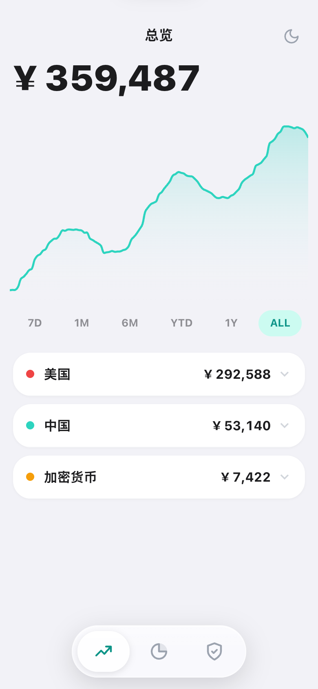
  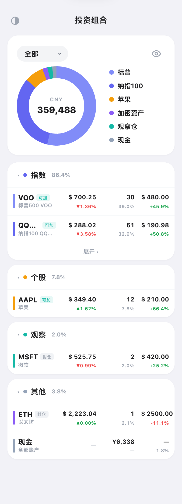
  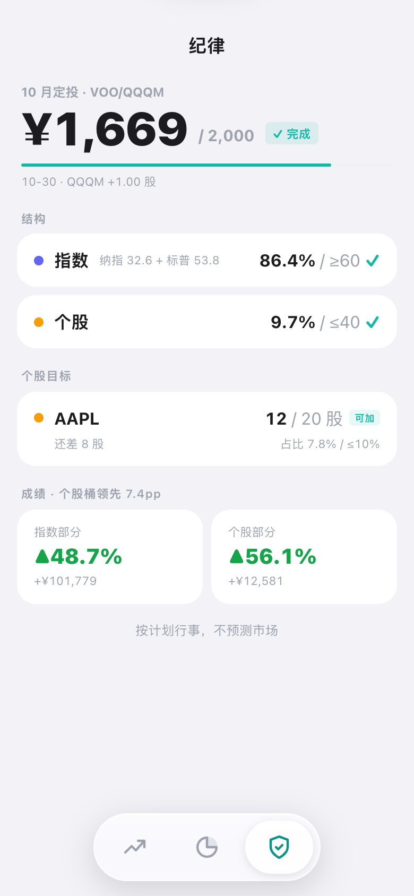
</p>

**总览**：总资产和资产曲线（7 天到全部），按地区汇总。盈亏默认藏起来，避免一打开就被涨跌牵着走。

**持仓**：饼图 + 分组列表。分组固定为四类：
- **指数**：纳指、标普等宽基；
- **个股**：占比 5% 以上，或者你给它设了"看占比"建仓规则的个股；
- **观察**：占比不到 5%、也没设建仓规则的小仓个股——试水的仓位，默认封仓；
- **其他**：现金、加密货币、警戒仓等。

每行旁边的 **可加 / 封仓** 签，就是按你写的规则算出来的；点开持仓能看到原因（比如"占比 7.8% < 8%"或"已买够 20/20 股"）。

**纪律**：
- 本月定投：选定的几只指数里任买一只，当月买够设定金额就打勾；
- 结构：指数占比是否达到下限、个股合计是否超过上限；
- 个股目标：设了目标股数的个股，显示买了多少、还差多少、占比离上限多远；
- 成绩：指数部分和个股部分各自的收益，放在一起比。

### 在页面上设规则

<p>
  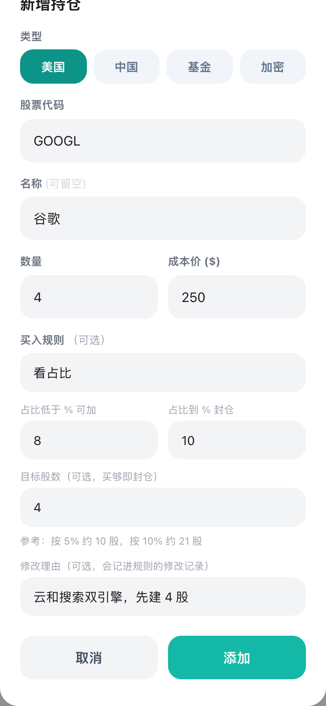
  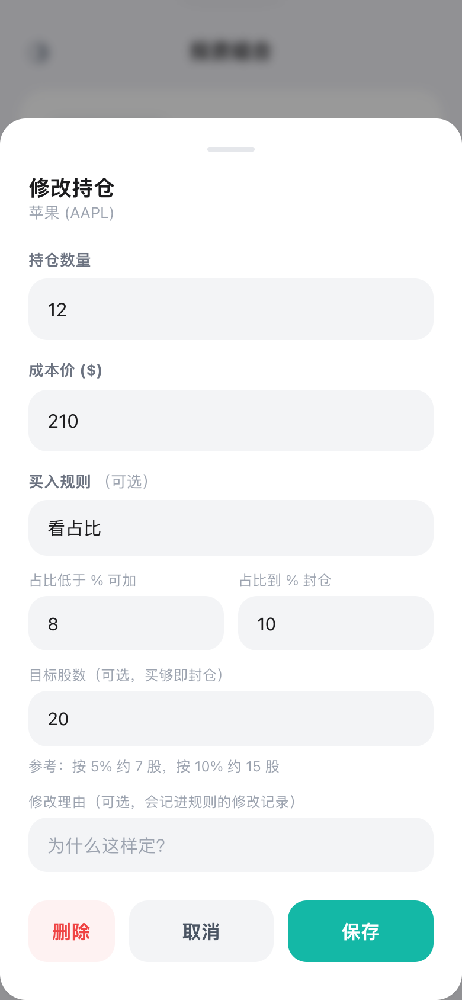
</p>

添加或修改持仓时，可以顺手设这只标的的买入规则：

| 规则 | 含义 |
|---|---|
| 不设 | 按默认处理（默认封仓）；个股会算作观察仓 |
| 一直可加 | 永远显示可加，适合定投的指数 |
| 看占比 | 占比低于「可加线」显示可加，到「封仓线」显示封仓；可选目标股数，买够即封 |
| 一直封仓 | 不再加仓，只持有 |

几个细节：
- 封仓线只管"还能不能加"，涨过了不代表要卖；
- 新增持仓时，目标股数默认等于这次买的股数——"一次买够、之后不动"；
- 表单下方会给参考股数（按总资产的 5% / 10% / 封仓线大约是多少股），只提示不自动填；
- 可以写一句修改理由；每次规则变化都会自动记进 `plan.json` 的 `changelog`（日期、改前改后、理由），方便以后回看"当时为什么这么定"。

### 深色模式

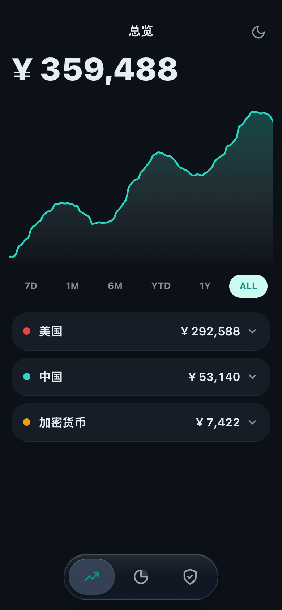

跟随系统，也可以手动切换。

### 电脑版

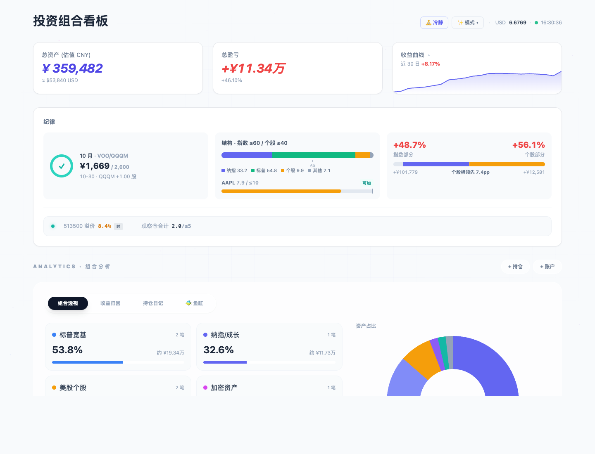

顶部是总资产、总盈亏、收益曲线；下面的**纪律卡**和手机纪律页同口径，另有一条"体检"带：场内 ETF 溢价、观察仓合计是否超标。

**组合透视**：按类型穿透看真实暴露（标普、纳指、个股、加密、现金各占多少）。

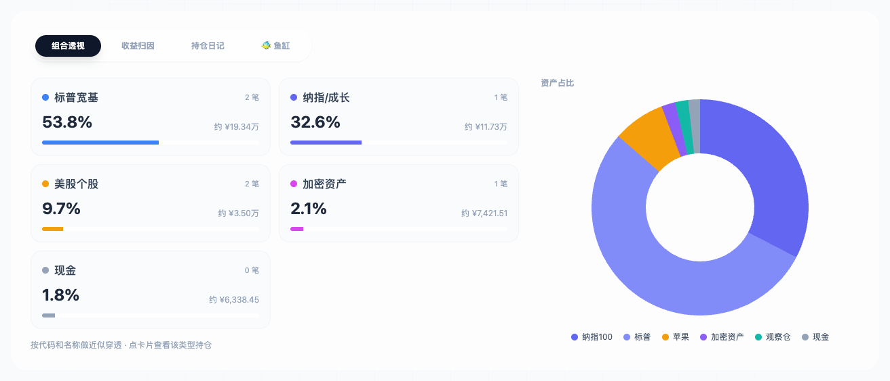

**收益归因**：每只持仓对总收益贡献了多少，一眼看出是谁在赚钱、谁在拖后腿。

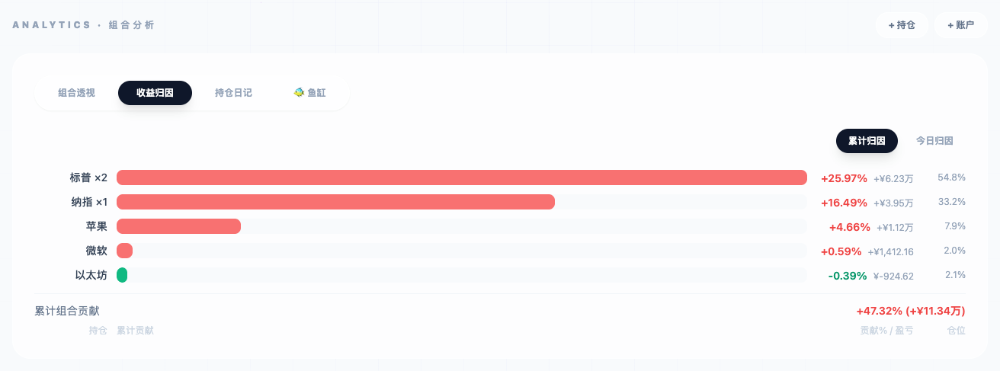

**持仓日记**：记录买入理由、持有思考、卖出计划，并自动附上当时的持仓盈亏。下次想冲动操作时，先回来看看当初怎么想的。

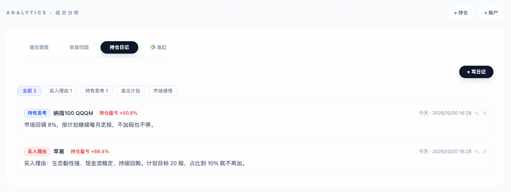

另外还有一个「鱼缸」页，把每只持仓画成一条鱼，纯属好玩。

## 快速开始

### 用 Docker（推荐）

```bash
git clone <本仓库地址> calm-portfolio
cd calm-portfolio
cp .env.example .env        # 按需修改, 比如设置 APP_PASSWORD
docker compose up -d
docker compose logs         # 没设 APP_PASSWORD 时, 这里能看到首次生成的登录密码
```

浏览器打开 `http://<你的服务器>:3457`，输入密码即可。手机上可以"添加到主屏幕"，当 App 用。

> Linux 上如果遇到 `data/` 目录写入权限问题：`sudo chown -R 1000:1000 data`（容器内以 uid 1000 运行）。

### 直接用 Node.js

需要 Node.js 18 以上。

```bash
npm ci
DEMO=1 node server.js       # DEMO=1: 首次启动载入虚构演示持仓, 先看看效果
```

数据默认存在 `./data/`，可以用 `DATA_DIR` 换位置。

## 配置你自己的规则

规则写在 `data/plan.json`。第一次可以复制示例改：

```bash
cp plan.example.json data/plan.json
```

主要字段：

| 字段 | 作用 |
|---|---|
| `targetAllocation` | 结构目标：指数下限、个股上限 |
| `channels.symbols` | 每只标的的买入规则，决定"可加 / 封仓"签 |
| `channels.indexPlan` | 每月指数定投：哪几只、多少钱算完成 |
| `groups` | 个人分组：警戒仓、非决策持仓（如券商赠股） |
| `motto` | 纪律页底部的一句话 |

`channels.symbols` 里每只标的选一种类型：

| 类型 | 规则 |
|---|---|
| `open` | 一直可加 |
| `seal` | 一直封仓 |
| `band` | 看占比：低于 `openBelowPct` 可加，到 `sealAtPct` 封仓；可选 `targetShares` 目标股数，买够即封 |
| `premium` | 场内 ETF 看溢价：不超过 `maxPremiumPct` 才可加 |
| `offshore` | 境外账户总额到 `offshoreTargetUSD` 后封仓 |

没写进表里的标的按 `default`（默认封仓）处理。思路是：**想买什么，先把规则写下来。**

`open` / `seal` / `band` 三种也可以直接在页面上设（见上面「在页面上设规则」）；溢价、境外这两种仍需在文件里改。

改完保存即可生效，不用重启。

## AI 顾问（可选）

<p>
  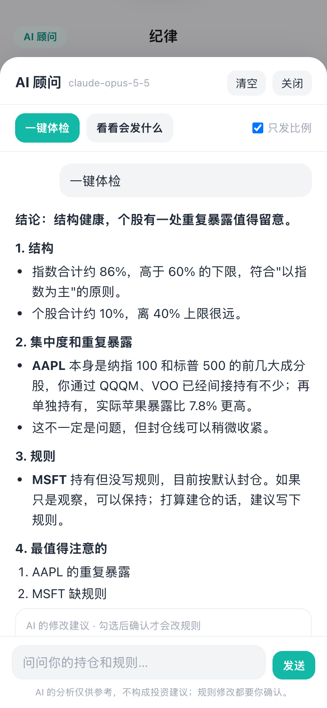
  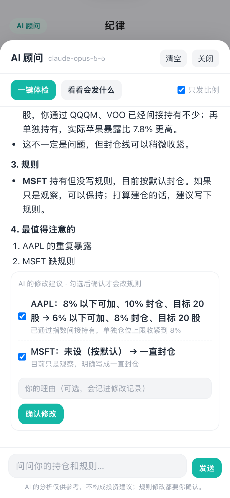
</p>

配置后，手机版纪律页左上角、电脑版右上角会出现「AI 顾问」：

- **一键体检**：对照你的规则看结构偏离、集中度、个股和指数的重复暴露、持有但没写规则的标的。
- **问答**：带着你的持仓和规则问问题，比如「我的个股上限合理吗」。
- **规则修改建议**：AI 觉得值得改时，会列出「改前 → 改后」，你勾选、写一句理由后才写进 `plan.json`。修改记录里会标明来源是 AI。

它**不做**的事：不预测涨跌、不给买卖时点、不推荐新股票、不能下单。占比、偏离、目标完成度这些数字都由看板先算好，AI 只负责解读，不自己算。

**隐私**：
- 默认「只发比例」：不发总资产、金额、股数、成本价，只发占比、盈亏百分比和规则。可以在面板里取消勾选。
- 点「看看会发什么」能先看到这次发给模型的完整内容。
- 想完全不出本机，可以用 Ollama 跑本地模型。
- API Key 只存在服务器的 `.env` 里，不会发到浏览器。

**配置**（`.env`，改完重启）：

```bash
# Claude（Anthropic 官方接口）
AI_PROVIDER=anthropic
AI_API_KEY=sk-ant-...
# AI_MODEL=claude-opus-5-5     # 默认就是它

# 或者任何 OpenAI 兼容接口，比如 DeepSeek
AI_PROVIDER=openai
AI_BASE_URL=https://api.deepseek.com/v1
AI_API_KEY=sk-...
AI_MODEL=deepseek-chat

# 或者本机 Ollama（不需要 key）
AI_PROVIDER=openai
AI_BASE_URL=http://localhost:11434/v1
AI_MODEL=qwen2.5:14b
```

可选：
- `AI_COOLDOWN_HOURS=24`：冷静期。你确认的修改先进入「待生效」，24 小时后才写入，期间可以在面板里撤销。默认 0，确认后立即生效。
- `AI_SEND_AMOUNTS=1`：默认也发金额和股数（面板里仍可切换）。

使用 Claude 时，看板会开启 Anthropic 的服务端兜底：模型因安全策略拒答时，由 Anthropic 自动换推荐模型重试。

## 券商同步（可选）

都是**只读**的：只查询持仓和成交，不会下单。规则都一样：第一次运行只记基线；之后只有券商那边有变化才写入看板；你手动改过的数不会被改回去。

| 方式 | 适用 | 配置说明 |
|---|---|---|
| Interactive Brokers | IB 用户，用官方 Flex 只读令牌 | [docs/brokers/ib.md](docs/brokers/ib.md) |
| 长桥 Longbridge | 长桥用户，用官方 OpenAPI | [docs/brokers/longbridge.md](docs/brokers/longbridge.md) |
| 导入 CSV | **任何券商**：导出持仓表，在电脑版导入 | [docs/brokers/csv.md](docs/brokers/csv.md) |
| 富途 / moomoo | 暂无内置，可导入 CSV 或自己接 OpenD | [docs/brokers/futu.md](docs/brokers/futu.md) |
| 自己写适配器 | 其他有接口的券商、或自己定时生成的文件 | [docs/brokers/custom.md](docs/brokers/custom.md) |

多个券商可以同时启用，手机端首页底部会各显示一行同步状态；令牌快到期时会提醒。

## 安全

- 默认**查看和修改都需要登录**。放在公网上时，请保持 `PUBLIC_READ=0`，并在前面加 HTTPS（Caddy / Nginx）。
- 密码只以加盐哈希保存在 `data/auth.json`。忘记密码：删掉这个文件重启，会生成新密码；或者设置 `APP_PASSWORD`。
- `data/` 里是你的全部持仓，记得定期备份：直接复制整个目录即可；也可以设置 `BACKUP_TOKEN`，用导出接口写自己的备份脚本。

## 行情数据来源

行情来自东方财富、新浪、腾讯、天天基金、上交所等公开接口，仅供个人自用。接口随时可能变动或限流；商业使用请自行取得授权。

## 免责声明

本项目只是一个记账和提醒工具。页面上的"可加 / 封仓"只是按**你自己写的规则**机械比较的结果，不构成任何投资建议。投资有风险，决策请自行负责。

## 开发

```bash
npm test        # 运行测试
```

## 许可证

[MIT](LICENSE)

## 致谢

用到的开源项目：[Chart.js](https://www.chartjs.org/)（MIT）、[Tailwind CSS](https://tailwindcss.com/)（MIT）、[ws](https://github.com/websockets/ws)（MIT）。
