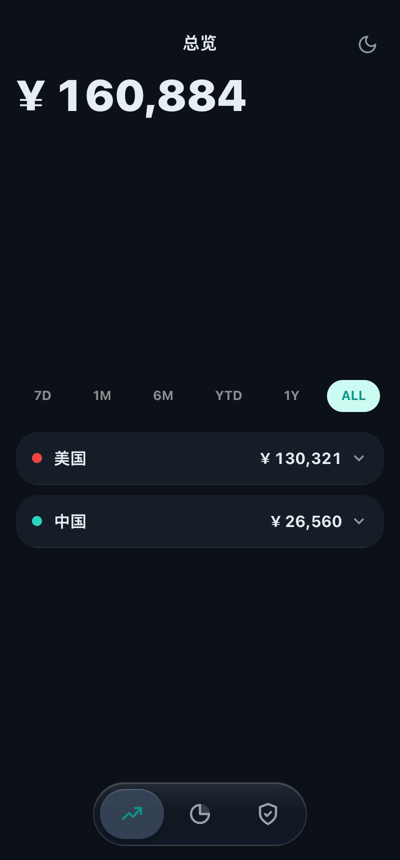
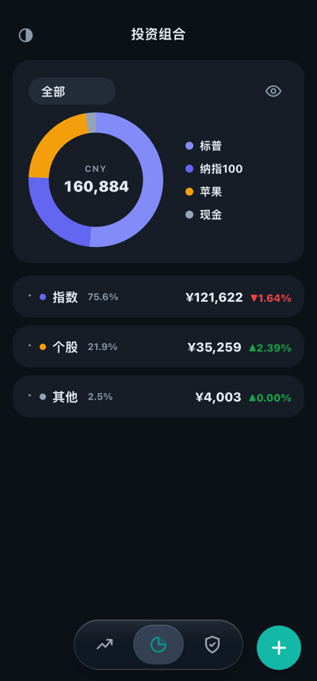
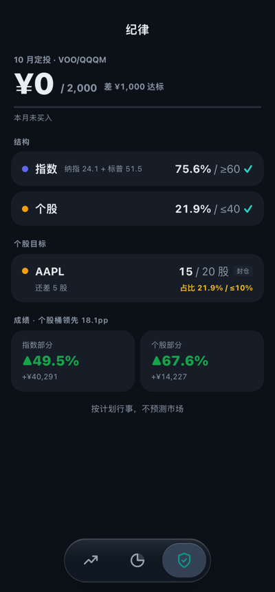
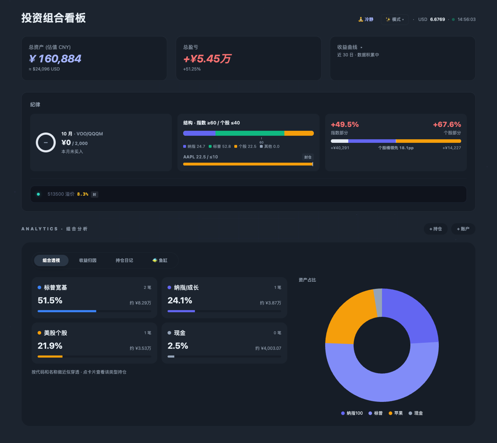

# Calm Portfolio · 冷静持仓

一个自己部署的持仓看板，给"想按自己定的规则长期投资、又不想天天盯盘"的人用。

- **多账户汇总**：A 股、场外基金、港股、美股、加密货币放在一起看，自动换算成人民币。
- **按你自己的规则提示"可加 / 封仓"**：每只标的旁边一个小签，告诉你按规则现在能不能加仓、为什么。
- **纪律页**：本月定投完成了没有、指数和个股的比例、个股买够了没有，一页看完。
- **电脑版分析**：组合透视（按类型穿透）、收益归因（每只持仓对总收益的贡献）、持仓日记（记录买入理由）、资产曲线、鱼缸可视化。
- **防焦虑设计**：首页默认不显示盈亏，轻点才展开、几秒后自动收起；颜色只用在需要注意的地方。
- **可选：Interactive Brokers 自动同步**：用 IB 的只读 Flex 令牌，成交和持仓自动写进看板。
- **数据都在你自己手里**：一个 Node.js 进程 + 几个 JSON 文件，没有数据库，没有第三方账号。

<p>
  
  
  
</p>

电脑版（宽屏，多了组合透视、收益归因、持仓日记）：



> 截图里是虚构的演示数据。手机访问首页自动进入手机版，电脑访问进入电脑版；也可以直接打开 `/m.html` 或 `/index.html`。

## 快速开始

### 用 Docker（推荐）

```bash
git clone <本仓库地址> calm-portfolio
cd calm-portfolio
cp .env.example .env        # 按需修改, 比如设置 APP_PASSWORD
docker compose up -d
docker compose logs         # 没设 APP_PASSWORD 时, 这里能看到首次生成的登录密码
```

浏览器打开 `http://<你的服务器>:3457`，输入密码即可。手机上可以"添加到主屏幕"，当 App 用。

> Linux 上如果遇到 `data/` 目录写入权限问题：`sudo chown -R 1000:1000 data`（容器内以 uid 1000 运行）。

### 直接用 Node.js

需要 Node.js 18 以上。

```bash
npm ci
DEMO=1 node server.js       # DEMO=1: 首次启动载入虚构演示持仓, 先看看效果
```

数据默认存在 `./data/`，可以用 `DATA_DIR` 换位置。

## 配置你自己的规则

规则写在 `data/plan.json`。第一次可以复制示例改：

```bash
cp plan.example.json data/plan.json
```

主要字段：

| 字段 | 作用 |
|---|---|
| `targetAllocation` | 结构目标：指数下限、个股上限 |
| `channels.symbols` | 每只标的的买入规则，决定"可加 / 封仓"签 |
| `channels.indexPlan` | 每月指数定投：哪几只、多少钱算完成 |
| `groups` | 个人分组：警戒仓、非决策持仓（如券商赠股） |
| `motto` | 纪律页底部的一句话 |

`channels.symbols` 里每只标的选一种类型：

| 类型 | 规则 |
|---|---|
| `open` | 一直可加 |
| `seal` | 一直封仓 |
| `band` | 看占比：低于 `openBelowPct` 可加，到 `sealAtPct` 封仓；可选 `targetShares` 目标股数，买够即封 |
| `premium` | 场内 ETF 看溢价：不超过 `maxPremiumPct` 才可加 |
| `offshore` | 境外账户总额到 `offshoreTargetUSD` 后封仓 |

没写进表里的标的按 `default`（默认封仓）处理。思路是：**想买什么，先把规则写下来。**

改完保存即可生效，不用重启。

## Interactive Brokers 自动同步（可选）

1. IB 后台 →「报表」→「Flex 查询」，新建两个查询：
   - 活动查询，包含 **Open Positions**（持仓）；
   - 交易确认查询，包含 **Trade Confirmations**（成交）。
2. 在「Flex Web Service」里生成令牌，建议设置 IP 白名单为你的服务器 IP。
3. 把令牌和两个查询编号填进 `.env`，重启。

同步规则：
- 美股交易时段每 10 分钟拉一次新成交，追加成买入 / 卖出记录；
- 每天早上按 IB 持仓对账一次，只有 IB 那边有变化时才更新看板，不会覆盖你的手动修改；
- 第一次运行只记录基线，不改任何数据；
- 令牌只读，程序不会、也不能下单；
- 如果某只股票除了 IB 还在别处持有一部分，可以用 `IB_SYNC_EXTRA` 告诉对账程序（见 `.env.example`）。

## 安全

- 默认**查看和修改都需要登录**。放在公网上时，请保持 `PUBLIC_READ=0`，并在前面加 HTTPS（Caddy / Nginx）。
- 密码只以加盐哈希保存在 `data/auth.json`。忘记密码：删掉这个文件重启，会生成新密码；或者设置 `APP_PASSWORD`。
- `data/` 里是你的全部持仓，记得定期备份：直接复制整个目录即可；也可以设置 `BACKUP_TOKEN`，用导出接口写自己的备份脚本。

## 行情数据来源

行情来自东方财富、新浪、腾讯、天天基金、上交所等公开接口，仅供个人自用。接口随时可能变动或限流；商业使用请自行取得授权。

## 免责声明

本项目只是一个记账和提醒工具。页面上的"可加 / 封仓"只是按**你自己写的规则**机械比较的结果，不构成任何投资建议。投资有风险，决策请自行负责。

## 开发

```bash
npm test        # 运行测试
```

## 许可证

[MIT](LICENSE)

## 致谢

用到的开源项目：[Chart.js](https://www.chartjs.org/)（MIT）、[Tailwind CSS](https://tailwindcss.com/)（MIT）、[ws](https://github.com/websockets/ws)（MIT）。
